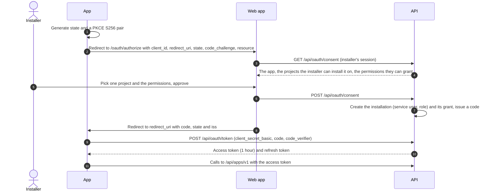

# App install

How an external app (a crawler, a messaging channel) gets installed on a project and calls the apps API. Apps are confidential OAuth clients of the API's authorization server ([ADR 0029](adr/0029-app-installs-on-the-oauth-server.md), on top of [ADR 0028](adr/0028-oauth-authorization-server.md)). A standard OAuth 2.1 client library works without anything specific to the platform.

API paths below include the private API prefix `/api`.

## Actors

| Actor | Role |
| --- | --- |
| **App manifest** | Catalog entry, created in the back-office: name, slug, grantable permissions, HTTPS redirect URIs. |
| **App client** | The OAuth client of the manifest: a `client_id` (`app_…`) and a `client_secret`, created in the back-office and shown once. |
| **Installer** | A project owner or admin, who holds `project.app_installation.create` on the project. |
| **Installation** | The app on one project: a service user, a project role with the granted permissions, and an OAuth grant. |

## Setting up an app

1. Create the manifest in the back-office, with its grantable permissions and redirect URIs (exact `https` URLs; loopback `http` is always accepted for local development).
2. Create the client secret: `POST /api/backoffice/apps/:appManifestId/oauth-client/secret` returns `{ clientId, clientSecret }`. The secret is shown once and stored hashed. Calling it again replaces the secret, and the previous one stops working at once.
3. Configure the app with the issuer `{API}/api/oauth`. Its metadata is at `{API}/.well-known/oauth-authorization-server/api/oauth`.

## Install flow



The authorization request is the standard one:

```
{WEB}/oauth/authorize
  ?response_type=code
  &client_id=app_…
  &redirect_uri={registered callback}
  &state={opaque value}
  &code_challenge={S256 challenge}
  &code_challenge_method=S256
  &resource={API}/api/apps/v1
```

`resource` is optional. When sent, it must be the apps API.

### What the installer can grant

- The page lists the projects where the installer holds `project.app_installation.create`, that is the projects they own or administer. Organization roles do not pass it down, and platform staff get no exception.
- An app is installed on one project at a time. Approving an app already installed on the project reconnects it: the installation stays, with its service user, conversations and document sources, its permissions become those just granted, and the previous refresh tokens stop working.
- The permissions offered are the manifest's grantable permissions that the installer holds on the project. An install never gives an app more than its installer has.

## Tokens

| | |
| --- | --- |
| Client authentication | `client_secret_basic` or `client_secret_post`, at the token and revocation endpoints. PKCE stays required. |
| Access token | `at+jwt` signed by the API, valid 1 hour. Subject: the installation's service user. Claims: `installation_id`, `grant_id`, `client_id`. Audience: `{API}/api/apps/v1`. |
| Refresh token | Opaque, rotated at each use, expires after 90 days without use. A refresh token used twice revokes the installation. |

`/api/apps/v1/*` loads the installation on every request: once it is revoked, the app stops at once, even with an access token still valid.

## Revocation

Revoking from either side ends both the grant and the installation:

- a project owner or admin revokes the installation in the studio (`project.app_installation.revoke`);
- the app revokes its refresh token at `POST /api/oauth/revoke` (RFC 7009), for example when it is uninstalled.

App installations do not appear in a person's "Connected apps", which lists their MCP clients only.

## Before ADR 0029

Apps used to install through a flow of their own ([ADR 0024](adr/0024-conversation-apps.md)): per-installation `client_id` and `client_secret`, a `client_credentials` token endpoint, and the global `app.install` permission for platform staff. It was removed with ADR 0029. The installations it made lost their credentials but stay active: their apps reconnect from the consent page and keep their conversations and document sources.

## Related code

| Area | Location |
| --- | --- |
| Contracts | `packages/api-contracts/src/oauth/`, `packages/api-contracts/src/apps/` |
| Authorization server | `apps/api/src/domains/oauth/` |
| Installations, service users, apps API guard | `apps/api/src/domains/apps/` |
| E2E | `apps/api/src/domains/oauth/e2e-tests/app-install.spec.ts` |
